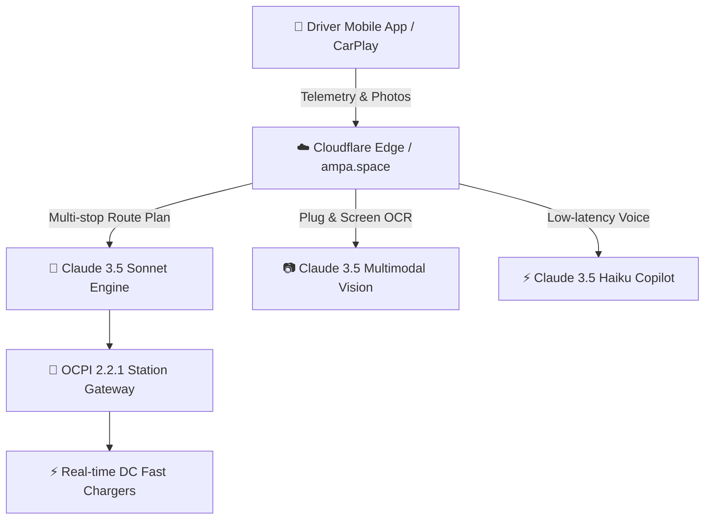

# AMPA — Intelligent EV Charging Network & Claude 3.5 AI Copilot SDK

[](https://ampa.space)
[](https://anthropic.com)
[](https://www.typescriptlang.org/)
[](https://opensource.org/licenses/MIT)
[](https://ampa.space)

**AMPA** ([ampa.space](https://ampa.space)) is an intelligent electric vehicle (EV) charging network and navigation platform engineered with React Native and TypeScript to solve range and charging anxiety across Southeast Asia.

AMPA integrates **Anthropic Claude 3.5 Sonnet & Haiku** as the foundational intelligence layer for real-time telemetry route planning, multimodal charger diagnostics, and hands-free conversational in-car assistance.

---

## 🚀 Key AI Capabilities



### 1. 🗺️ AI Route Optimizer (Claude 3.5 Sonnet)
- **Physics-Informed Elevation Compensation**: Dynamically models potential energy penalties ($\Delta E = \frac{m \cdot g \cdot \Delta h}{\eta}$) when climbing steep mountain passes (e.g., +1,450m elevation from Ho Chi Minh City to Da Lat).
- **SoC & Charging Curve Optimization**: Recommends charging sessions strictly within the optimal 10%–80% battery curve to minimize dwell time.
- **Dynamic Charger Availability & Wait-Time Modeling**: Avoids congested hubs and routes drivers to available high-power stalls (120kW–250kW).

### 2. 📷 Multimodal Vision Diagnostics (Claude 3.5 Sonnet Vision)
- **Connector Classification**: Inspects photographs to classify charging standards: **CCS2**, **CHAdeMO**, **Type 2**, **GB/T**, or **Tesla NACS**.
- **Hardware & Screen OCR Troubleshooting**: Detects bent pins, physical damage, and decodes cryptic station error codes (e.g., `0x4B Control Pilot Drop`) with step-by-step resolution advice.

### 3. 🎙️ In-Car Voice Copilot (Claude 3.5 Haiku)
- Sub-500ms voice/text conversational assistant designed for drivers on the road.
- Hands-free station search, detour rerouting, and real-time charging status updates.

---

## 📦 Architecture & Directory Structure

```text
ampa/
├── src/
│   ├── copilot/
│   │   ├── routeOptimizer.ts     # Physics-informed SoC & elevation itinerary engine
│   │   ├── visionDiagnostics.ts  # Multimodal photo inspection & error code parser
│   │   └── assistant.ts          # In-car conversational voice/text assistant
│   ├── types/
│   │   └── index.ts              # Zod schemas & TypeScript definitions
│   └── index.ts                  # Public SDK entrypoint
├── demo/
│   └── cli.ts                    # End-to-end simulation runner
├── package.json
├── tsconfig.json
├── LICENSE                       # MIT License
└── README.md
```

---

## ⚡ Quickstart

### Installation

```bash
git clone https://github.com/trucuit/ampa.git
cd ampa
npm install
```

### Run the Simulation CLI

```bash
npm run demo
```

Output:
```text
⚡ ========================================================
⚡ AMPA — Intelligent EV Charging Network & Copilot Demo
⚡ Powered by Anthropic Claude 3.5 Sonnet & Haiku
⚡ Official Website: https://ampa.space
⚡ ========================================================

[1/3] 🗺️ Calculating EV Multi-Stop Itinerary (HCMC -> Da Lat, +1,450m elevation)...
✅ Total Distance: 305 km
✅ Elevation Energy Penalty: +9.74 kWh
✅ Recommended Charging Stop: AMPA Supercharge Bảo Lộc Hub (28 mins)
💡 Copilot Insight: Optimal 180kW DC fast charging window before mountain climb.

[2/3] 📷 Simulating Multimodal Claude Vision Diagnostic...
✅ Connector: CCS2 (Confidence: 98.5%)
✅ Error Analysis: 0x4B (CP_PILOT_VOLTAGE_DROP)
✅ Suggested Action: Firmly unseat connector, inspect latch mechanism for debris, and re-insert.

[3/3] 🎙️ In-Car Voice Copilot Response:
🤖 Claude Haiku: "Hiện tại xe bạn còn 58% pin (235km). Trên cung đường đi Đà Lạt..."
```

---

## 🛡️ Enterprise Security & Privacy

- **Zero Training on Customer Data**: Prompts and driver telemetry processed through Anthropic's enterprise commercial API are never used to train foundational AI models.
- **Data Governance**: Full compliance with AMPA's published [Privacy Policy](https://ampa.space/privacy) and [Terms of Service](https://ampa.space/terms).
- **Transport Security**: TLS 1.3 encryption across all Cloudflare edge routes.

---

## 🌐 Links & Contact

- **Website**: [https://ampa.space](https://ampa.space)
- **Legal & Compliance**: [Privacy Policy](https://ampa.space/privacy) | [Terms of Service](https://ampa.space/terms)
- **Founder & CEO**: Truc Tran ([founder@ampa.space](mailto:founder@ampa.space))
- **GitHub**: [https://github.com/trucuit/ampa](https://github.com/trucuit/ampa)
